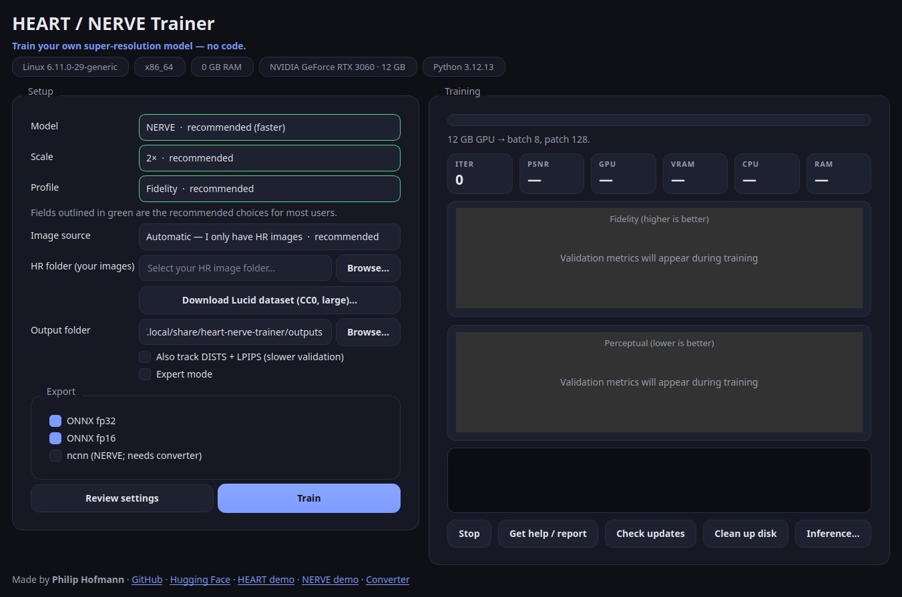

<div align="center">

# HEART / NERVE Trainer

### Train your own image upscaler — no code.

Pick a model, point at a folder of photos, press **Train**.
When it finishes, you get a model you can use anywhere.

[](https://github.com/Phhofm/heart-nerve_trainner/releases/latest)

[](https://github.com/Phhofm/heart-nerve_trainner/actions/workflows/ci.yml)
[](https://github.com/Phhofm/heart-nerve_trainner/releases)
[](LICENSE)
[](#download)



</div>

---

## What is this?

A friendly desktop app for **training super-resolution models**. In plain words:
it teaches an AI to make images **bigger and sharper** using your own photos.

- **No terminal, no Python, no config files.**
- **Sensible defaults** — the recommended choices are pre-selected and outlined in green.
- **Live feedback** — progress bar, live PSNR/SSIM graphs, and a log you can read.
- **It exports for you** — `.safetensors`, ONNX (fp32 + fp16), and ncnn for NERVE.

> Built on the open-source [traiNNer-redux](https://github.com/the-database/traiNNer-redux)
> engine. The app sets everything up in its own folder; your system Python is never touched.

## Download

| Your system | Get |
|---|---|
| **Windows** | [HeartNerveTrainer-Setup.exe](https://github.com/Phhofm/heart-nerve_trainner/releases/latest/download/HeartNerveTrainer-Setup.exe) |
| **Linux** | [HeartNerveTrainer-linux-x86_64.tar.gz](https://github.com/Phhofm/heart-nerve_trainner/releases/latest/download/HeartNerveTrainer-linux-x86_64.tar.gz) |

**Linux** is a portable bundle — no install:

```bash
tar xzf HeartNerveTrainer-linux-x86_64.tar.gz
./HeartNerveTrainer/HeartNerveTrainer
```

If it complains about the Qt `xcb` plugin on a fresh Debian/Ubuntu:

```bash
sudo apt install libxcb-cursor0 libxkbcommon-x11-0 libxcb-icccm4 \
  libxcb-image0 libxcb-keysyms1 libxcb-render-util0
```

## Train your first model

1. **First run** → click **Set up**. It downloads PyTorch into the app's own folder
   (one time, ~2–3 GB). Your system is not modified.
2. **Choose your images** → point **HR folder** at a folder of good-quality images,
   or click **Download Lucid dataset** for free CC0 training data.
3. **Press Train** → keep the green defaults (**NERVE · 2× · Fidelity**).
   Watch the progress bar and the graphs. When it finishes, the model is exported
   automatically to the **Output folder**.

That's it. The next-step hint in the app always tells you what to do.

## Is my GPU supported?

- **NVIDIA** — recommended and fully supported (bf16 on RTX 30/40, fp16 on older cards).
- **CPU** — works, but training is very slow.
- **AMD / Intel Arc** — not supported yet (the training engine assumes CUDA).

No GPU is needed to *browse*, but training a useful model wants an NVIDIA card.

## What you get

| File | Use |
|---|---|
| `.safetensors` | Weights for PyTorch, chaiNNer, ComfyUI |
| `.onnx` (fp32/fp16) | Portable inference, TensorRT, ONNX Runtime |
| `.ncnn` (NERVE) | Lightweight/edge inference |

Profiles: **Fidelity** (clean, default), **Perceptual** (sharper textures), **Real-world**
(robust to blur/noise/JPEG). Advanced knobs live behind **Expert mode**.

## Troubleshooting

- **Out of memory** → the app automatically retries with a smaller patch/batch.
- **Training is slow** → check the GPU meter; close other GPU apps.
- **Something failed** → press **Get help / report**. It copies a friendly, plain-language
  report to your clipboard that you can paste into an AI assistant or a forum.
  Nothing is sent anywhere automatically.
- **App won't start on Linux** → install the xcb packages listed above.

## For developers

<details>
<summary><b>Build, test, and package</b></summary>

```bash
python -m venv .venv && . .venv/bin/activate
pip install -e ".[dev,train]"

pytest -q          # 39 tests (parser, configs, updater, GUI smoke)
python app.py      # launch the GUI
hnt detect         # print detected hardware
hnt selftest       # end-to-end: train → validate → save → export
```

- **CI** runs the full test suite on every push and pull request
  (`.github/workflows/ci.yml`).
- **Releases** are built by `.github/workflows/build-release.yml` on a `v*` tag:
  portable Linux bundle + AppImage + Windows installer.
- The frozen app is a thin UI; training/export/inference run in the isolated venv.

Packaging:

```bash
python packaging/make_vendor.py --trainer /path/to/traiNNer-redux
bash packaging/linux/build_portable.sh
```

Layout: `hnt/` app (paths, hardware, presets, config, runner, exporter, UI),
`tests/` pytest suite, `docs/` website, `packaging/` installers, `packaging/vendor/`
pinned trainer.

</details>

## Credits

Made by **Philip Hofmann** — [GitHub](https://github.com/Phhofm) ·
[Hugging Face](https://huggingface.co/Phips).
Demos: [HEART](https://huggingface.co/spaces/Phips/heart) ·
[NERVE](https://huggingface.co/spaces/Phips/nerve) ·
[Converter](https://huggingface.co/spaces/Phips/nerve-convert).

MIT licensed. Built on [traiNNer-redux](https://github.com/the-database/traiNNer-redux).
